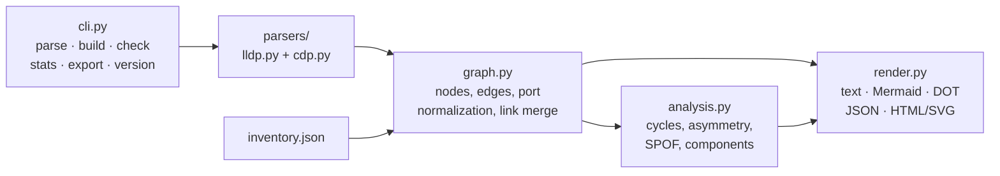

# topology-mapper

[](https://github.com/jeremydacosta-TechOptimist/topology-mapper/actions/workflows/ci.yml)
[](https://www.python.org/)
[](LICENSE)

Builds a network topology graph from per-device LLDP and CDP neighbor dumps, highlights operational risks (loops, asymmetric links, undeclared devices, single points of failure) and exports Mermaid, Graphviz DOT, JSON and standalone HTML maps.

Engineers rarely have a clean topology source: the only reliable data is what each switch reports about its neighbors. `topomapper` turns a directory of `show lldp neighbors detail` / `show cdp neighbors detail` dumps into one deterministic graph, cross-checks both protocols, and points at the parts of the network that will hurt during an incident.

## Features

- Parses Cisco IOS-style LLDP and CDP detail dumps, including leading spaces, partial blocks and multi-line version sections.
- Normalizes interface names (`GigabitEthernet0/1` to `Gi0/1`, plus `TenGigabitEthernet`, `FastEthernet`, `Port-channel`, `Loopback`, `Vlan` and more).
- Merges LLDP and CDP views of the same link into one edge with both protocols recorded.
- Builds a deterministic undirected graph with roles and management addresses from an optional JSON inventory.
- Detects loops, one-sided links, mention-only devices, parallel links, isolated devices, disconnected components and single points of failure.
- Exports Mermaid, Graphviz DOT, structured JSON and a standalone HTML page with a static SVG circular map.
- Exit codes: `0` clean, `1` error-level findings or runtime failure, `2` bad usage.

## Quick start

Requires Python 3.10+ and nothing else.

```bash
git clone https://github.com/jeremydacosta-TechOptimist/topology-mapper.git
cd topology-mapper
pip install -e .
topomapper version
```

```text
topomapper 1.0.0
```

From a checkout you can also run `python -m topomapper` with `PYTHONPATH=src`.

## Usage

The committed lab fixtures in `examples/lab-topology/` contain a triangle loop, one asymmetric link and one device that is mentioned but never dumped; see `examples/lab-topology/README.md` for the full list.

### Risk report

```console
$ topomapper check --dir examples/lab-topology --inventory examples/lab-topology/inventory.json
Topology check: examples/lab-topology
Metric     Value
---------  ----------------------------
Devices    5 (4 dumped, 1 mention-only)
Links      5 (3 symmetric, 2 one-sided)
Protocols  lldp 5 edges, cdp 3 edges
Findings   1 error, 3 warnings, 0 info

ID               Severity  Nodes                          Message
---------------  --------  -----------------------------  -------------------------------------------------------------------------------------
TOPO-CYCLE       error     core-sw, floor1-sw, floor2-sw  Loop detected: core-sw -> floor1-sw -> floor2-sw -> core-sw
TOPO-ASYMMETRIC  warning   floor1-sw, floor2-sw           One-sided link between floor1-sw and floor2-sw: only floor1-sw reports the connection
TOPO-SPOF        warning   core-sw                        Single point of failure: core-sw (removing it partitions the topology)
TOPO-UNDECLARED  warning   fw1                            Device mentioned but not dumped: fw1 (seen from core-sw)

Result: FAILED (error-level findings)
```

The command exits with code 1 because `TOPO-CYCLE` is error-level; `check --json` returns the same findings as a machine-readable document.

### Topology statistics

```console
$ topomapper stats --dir examples/lab-topology --inventory examples/lab-topology/inventory.json
Topology statistics: examples/lab-topology

Metric      Value
----------  ----------------------------------------
Devices     5 (4 dumped, 4 declared, 1 mention-only)
Links       5 (3 symmetric, 2 one-sided)
Protocols   lldp 5, cdp 3, merged 3
Components  1 (sizes: 5)
Degree      min 1, max 4, average 2.0
Roles       access 2, core 1, edge 1, unknown 1
Isolated    none
Findings    1 error, 3 warnings, 0 info
```

### Neighbor parsing

```console
$ topomapper parse --dir examples/lab-topology
Device     Protocol  Local port            Remote device  Remote port           Mgmt IP
---------  --------  --------------------  -------------  --------------------  -----------
core-sw    cdp       GigabitEthernet1/0/1  floor1-sw      GigabitEthernet1/0/1  192.0.2.11
core-sw    cdp       GigabitEthernet1/0/2  floor2-sw      GigabitEthernet1/0/1  192.0.2.12
core-sw    lldp      GigabitEthernet1/0/1  floor1-sw      GigabitEthernet1/0/1  192.0.2.11
core-sw    lldp      GigabitEthernet1/0/2  floor2-sw      GigabitEthernet1/0/1  192.0.2.12
core-sw    lldp      GigabitEthernet1/0/3  edge-rtr       GigabitEthernet0/0    192.0.2.254
core-sw    lldp      GigabitEthernet1/0/4  fw1            Ethernet0/1           192.0.2.200
edge-rtr   cdp       GigabitEthernet0/0    core-sw        GigabitEthernet1/0/3  192.0.2.1
edge-rtr   lldp      GigabitEthernet0/0    core-sw        GigabitEthernet1/0/3  192.0.2.1
floor1-sw  cdp       GigabitEthernet1/0/1  core-sw        GigabitEthernet1/0/1  192.0.2.1
floor1-sw  lldp      GigabitEthernet1/0/1  core-sw        GigabitEthernet1/0/1  192.0.2.1
floor1-sw  lldp      GigabitEthernet1/0/2  floor2-sw      GigabitEthernet1/0/2  192.0.2.12
floor2-sw  cdp       GigabitEthernet1/0/1  core-sw        GigabitEthernet1/0/2  192.0.2.1
floor2-sw  lldp      GigabitEthernet1/0/1  core-sw        GigabitEthernet1/0/2  192.0.2.1

13 neighbor records (8 LLDP, 5 CDP) from 4 device dumps
```

### Export a diagram

```console
$ topomapper export --dir examples/lab-topology --inventory examples/lab-topology/inventory.json --format mermaid --out out/lab.mmd
Wrote Mermaid map: 5 devices, 5 edges -> out/lab.mmd
$ cat out/lab.mmd
graph LR
    n0["core-sw<br/>core | 192.0.2.1"]
    n1["edge-rtr<br/>edge | 192.0.2.254"]
    n2["floor1-sw<br/>access | 192.0.2.11"]
    n3["floor2-sw<br/>access | 192.0.2.12"]
    n4["fw1<br/>unknown | 192.0.2.200 | not dumped"]
    n0 ---|"Gi1/0/1 &lt;-&gt; Gi1/0/1"| n2
    n0 ---|"Gi1/0/2 &lt;-&gt; Gi1/0/1"| n3
    n0 ---|"Gi1/0/3 &lt;-&gt; Gi0/0"| n1
    n0 -.-|"Gi1/0/4 &lt;-&gt; Et0/1"| n4
    n2 -.-|"Gi1/0/2 &lt;-&gt; Gi1/0/2"| n3
    classDef error fill:#f8d7da,stroke:#b02a37,stroke-width:2px
    classDef warning fill:#fff3cd,stroke:#997404,stroke-width:2px
    classDef info fill:#d1e7dd,stroke:#146c43,stroke-width:2px
    class n0,n2,n3 error
    class n4 warning
```

Solid lines are links reported from both ends; dotted lines are one-sided reports. The other formats are `--format dot|json|html`; the HTML export is a single self-contained file with an inline SVG map, legend and findings table.

## Architecture



`cli.py` parses arguments and dispatches to one handler per subcommand. Each device dump is parsed into normalized `Neighbor` records, then `graph.py` merges the LLDP and CDP views of the same local port into a deterministic undirected graph. `analysis.py` walks that graph (DFS for cycles and articulation points, adjacency checks for asymmetry and components) and returns sorted findings. `render.py` consumes the same graph and findings for every output format, so the text report, JSON document and drawings never disagree. The optional inventory only declares metadata; it never overrides what the dumps actually report.

## Project layout

```
topology-mapper/
├── .github/workflows/ci.yml
├── .gitignore
├── LICENSE
├── README.md
├── pyproject.toml
├── examples/lab-topology/
│   ├── README.md
│   ├── core-sw.txt
│   ├── edge-rtr.txt
│   ├── floor1-sw.txt
│   ├── floor2-sw.txt
│   └── inventory.json
├── src/topomapper/
│   ├── __init__.py
│   ├── __main__.py
│   ├── analysis.py
│   ├── cli.py
│   ├── errors.py
│   ├── graph.py
│   ├── models.py
│   ├── render.py
│   └── parsers/
│       ├── __init__.py
│       ├── cdp.py
│       └── lldp.py
└── tests/
    ├── helpers.py
    └── test_*.py          # 8 test modules
```

## Testing

```powershell
# from the repository root
$env:PYTHONPATH = "src"
py -3.13 -m pytest -q
python -m unittest discover -s tests
```

The current run reports `193 passed, 6 subtests passed` with pytest and `Ran 193 tests ... OK` with unittest. The 193 `unittest.TestCase` methods contain 379 assertions and run fully offline: no network access, no temporary files left behind. Coverage includes both parsers field by field, port normalization, LLDP/CDP merge, deterministic graph and exporter output, cycle and articulation-point correctness, escaping in Mermaid/DOT/JSON/HTML, CLI output and exit codes. CI runs the suite on Python 3.10, 3.11, 3.12 and 3.13.

## Roadmap

- Parse Juniper `show lldp neighbors` and Arista JSON outputs into the same graph model.
- Add a `diff` command that compares two graph exports and lists added/removed links.
- Offer an interactive HTML map with pan/zoom while keeping the export dependency-free.

## Resumo em português (PT-PT)

- Constrói um grafo de topologia de rede a partir de dumps de vizinhos LLDP e CDP, sem dependências externas.
- Normaliza nomes de interfaces e funde as vistas LLDP e CDP do mesmo link numa única ligação.
- Deteta ciclos, ligações unilaterais, equipamentos referidos mas não inventariados, ligações redundantes e pontos únicos de falha.
- Exporta mapas em Mermaid, Graphviz DOT, JSON e uma página HTML autónoma com SVG incorporado.
- Inclui uma suite de testes offline e corre em Python 3.10 ou superior.

## License

MIT © 2026 Jeremy da Costa. See [LICENSE](LICENSE).
